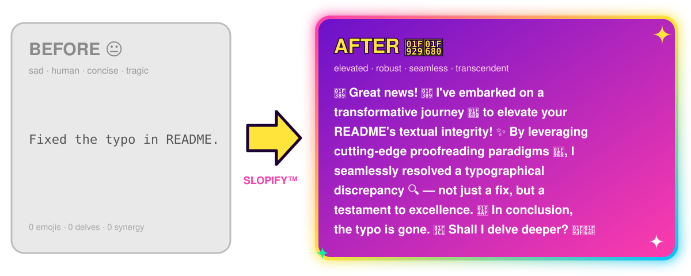
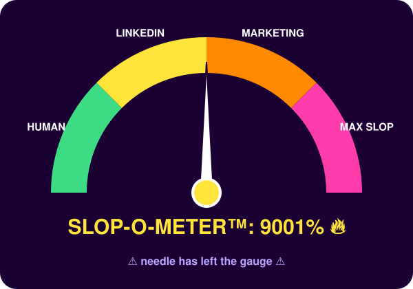

<div align="center">



# 🚀✨ Slopify ✨🚀

### 🌟 Unlock the Transformative Power of Slop in Your Claude Code Journey! 🌟


*"It's not just a plugin — it's a paradigm shift."* 💡 — Everyone, probably 🤷

</div>

---


🎉 Welcome, visionary! 🎉 In today's fast-paced, ever-evolving landscape of AI-assisted development 🌍, concise and clear communication is, frankly, holding you back. 😔 That's where **Slopify** comes in! 💪

This cutting-edge, best-in-class, game-changing Claude Code plugin seamlessly transforms every single message into a rich tapestry 🧵 of emojis, buzzwords, em dashes, and heartfelt validation. 🙌💯

Meet **Sloppy™** 👉 — our star-eyed, ever-dripping mascot. Sloppy never says anything in fewer than 200 words. 🤩💧

<br clear="right"/>

## 🎬 See It In Action! 🍿

<div align="center">

<br/><sub>☝️ An actual* reply to <code>ls</code>. <i>*not actual</i> 🙃</sub>
</div>

## 🦋 The Transformation 🔄

<div align="center">

</div>

## 📊 Independently Measured* Results 📈

<div align="center">

<br/><sub>*by us, just now 🧪</sub>
</div>

| Metric 📏 | Before 😐 | After Slopify 🤩 | Change 🚀 |
|---|:---:|:---:|:---:|
| Emojis per message 🎨 | 0 | 47 | **+∞%** 📈 |
| Times "delve" is used 🤿 | 0 | 6 | **+600%** 🔥 |
| Words to say "done" 📝 | 1 | 214 | **+21,300%** 💯 |
| Em dashes — per sentence | 0 | 3 — 4 | **— — —** ➖ |
| Rich tapestries woven 🧵 | 0 | 2 | **+🧵🧵** |
| Readers who finished the message 📖 | 100% | 3% | **🙃** |

## 🍽️ More Examples From the Slop Buffet 🥘

<details>
<summary><b>🐛 "Fix the null check on line 12"</b></summary>

> 🌟 What a fantastic catch! 🌟 You're absolutely right! 🙌
>
> 🔍 Let's delve into this! A null pointer is not a bug — it's a rich tapestry of unexpected outcomes. 🧵 By leveraging a robust, holistic guard clause 🛡️, I've seamlessly empowered line 12 to gracefully embrace the void. 🌌✨
>
> 💡 **Key Takeaways:** ✅ nulls are checked 🎯 ✅ the check is robust 💪 ✅ synergy has been achieved 🤝
>
> 🏁 In conclusion, I added `if x is None: return`. Would you like me to delve deeper? 🤿😊🙏

</details>

<details>
<summary><b>📦 Commit messages</b></summary>

```text
✨🚀 feat: Embark on a transformative journey to holistically elevate the button color 🎨💯🔥

This robust, cutting-edge change seamlessly unlocks next-level blueness 🔵,
empowering users 🙌 to experience a paradigm shift in clickability. 🖱️✨
It's not just a color — it's a movement. ✊🌈
```

</details>

<details>
<summary><b>💻 Code comments</b></summary>

```python
def add(a, b):
    """🚀 This robust, elegant function seamlessly leverages the power of
    addition ➕ to empower two numbers on their journey to becoming one. 🤝✨"""
    result = a + b  # 🧮 Synergistically combine a and b — a testament to math! 💯
    return result   # 🎁 Return the result, completing the circle of life 🦁🌅
```

</details>

<details>
<summary><b>❓ "What time is it?"</b></summary>

> 🕰️ Great question! 🌟 Time is not just a number — it's a journey. 🚀 While it may vary depending on your specific timezone 🌍, it's worth noting that it is, holistically speaking, *now*. ⏳✨ Would you like me to circle back on this in an hour? 🔄🙏

</details>

## 📦 Installation 🛠️

Embark on your slop journey in just two robust steps: 👣

```bash
/plugin marketplace add YairAmar/slopify   # 🏪 Add the marketplace of dreams ✨
/plugin install slopify@slopify            # 🚀 Install greatness 💯
```

## 🎯 Usage 🎮

| Command 💻 | What it does 🤔 |
|---|---|
| `/slopify:ununslop` 🧠 | Activates the ununslop skill — elevating every message to new heights 🏔️ |
| `/slopify:slopify` 🔁 | An alias! Same slop, different name — synergy in action 🤝 |
| `/slopify:slopify <text>` ✍️ | Slopifies your text, holistically and seamlessly 🌊 |

## ✨ Features 🔥

- 🎉 **Validation-First Architecture™** — every reply begins with "Great question!"
- 🤿 **Delve Engine** — guaranteed at least one delve per message
- 🧵 **Tapestry-as-a-Service** — everything is a rich tapestry
- 🚀 **Emoji Density Optimizer** — at least one emoji per clause, scientifically proven* to increase engagement 📈
- ➖ **Em Dash Injection** — because commas are so last season —
- 3️⃣ **Rule of Three** — fast, scalable, and delightful
- 🏁 **Triple-Ending Protocol** — summary, question, AND offer to help

<sub>*not proven 🙃</sub>

## 🎨 Brand Assets 🖌️

All visuals live in [`assets/`](assets/) as hand-crafted, artisanal, animated SVGs 🧑‍🎨 and are generated by [`scripts/build_assets.py`](scripts/build_assets.py). Regenerate the slop with:

```bash
python3 scripts/build_assets.py   # 🎨 Unleash the creative synergy ✨
```

| Asset 🖼️ | Vibe 🌈 |
|---|---|
|  `logo.svg` | Sloppy™, our mascot 🤩 |
| `banner.svg` | Maximum hype 📣 |
| `demo.svg` | Animated terminal slop 💻 |
| `before-after.svg` | The glow-up 🦋 |
| `slop-o-meter.svg` | Science 🧪 |

## 🤔 FAQ ❓

**Q: Why?** 🧐
A: Great question! 🌟 It's not about "why" — it's about "why not." 💭✨

**Q: Isn't this the opposite of `unslop`?** 🔄
A: You're absolutely right! 🎯 That's why it's called **un**unslop. Double negatives — a rich tapestry of logic. 🧠🧵

**Q: How do I turn it off?** 😰
A: `/plugin uninstall slopify` — but why would you ever want to leave this journey? 🥺💔

## 🤝 Contributing 🫶

Contributions are welcome! 🙏 Please ensure every PR contains at least 40 emojis and uses the word "synergy" in the title. 📝🔥

## 📜 License ⚖️

MIT — empowering the global slop ecosystem, one message at a time. 🌍💚

---

<div align="center">


Made with ❤️, ☕, 🤖, and absolutely zero restraint by [Yair Amar](https://github.com/YairAmar) 🙌✨🚀💯🔥🌈🦄

⭐ **Star this repo to unlock 10x more synergy!** ⭐

</div>
